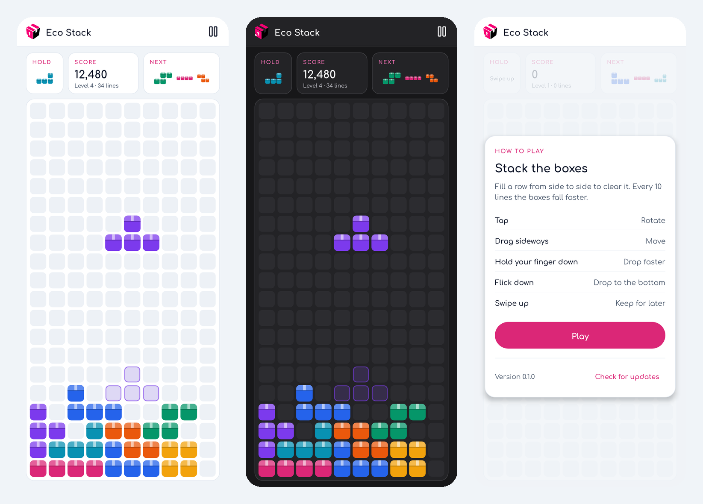
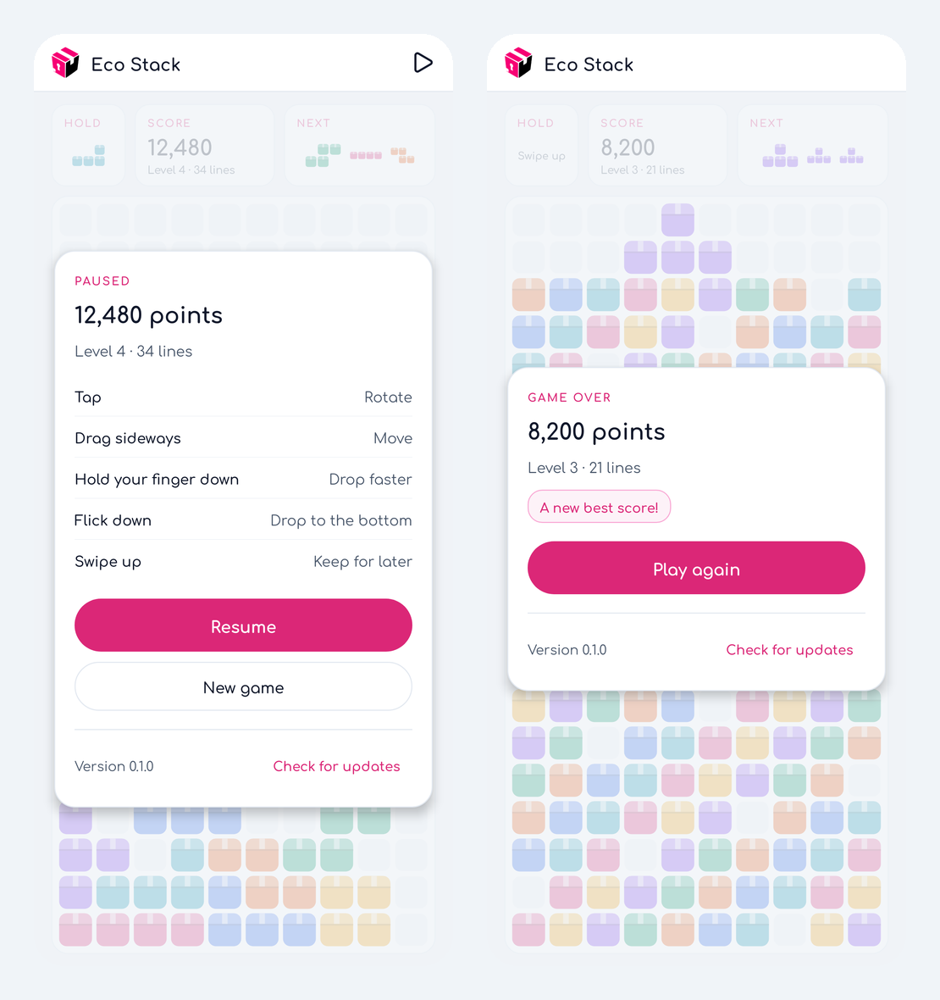

# Eco Stack releases

Downloads for **Eco Stack**, a falling-blocks puzzle game for Android in the Eco-Storage dashboard's
design: the rose accent, neutral surfaces and Comfortaa typeface, light or dark like your phone, with
the pieces drawn as little storage boxes.

This repository holds only release files; the game's source lives elsewhere.

## Install

1. On the phone, open the [latest release](../../releases/latest) and download `eco-stack-X.Y.Z.apk`.
2. Open the file. Android asks once to allow installs from your browser or files app.
3. Open **Eco Stack** and press **Play**.

## How to play

| Gesture | Does |
| --- | --- |
| Tap | Rotate |
| Drag sideways | Move |
| Hold your finger down | Drop faster, until you lift it |
| Flick down | Drop straight to the bottom |
| Swipe up | Keep the piece for later (Hold) |

Fill a row from side to side to clear it. Every 10 lines the game goes up a level and the boxes fall
faster. Clearing four lines at once scores the most, and four after four scores half as much again.

The game pauses by itself when you leave it, pull down the notifications or press Back, and picks up
where you left off next time. Your best score stays on the phone.

## Updates

Eco Stack checks this repository once a day, or when you press **Check for updates** on the pause
screen. When a newer release is here it shows **Install**; Android asks once to allow installs from
Eco Stack. Updating keeps your best score and a paused game.

## Credits and licences

The app bundles the Comfortaa typeface (SIL Open Font License) and [Lucide](https://lucide.dev/) icons (ISC).
